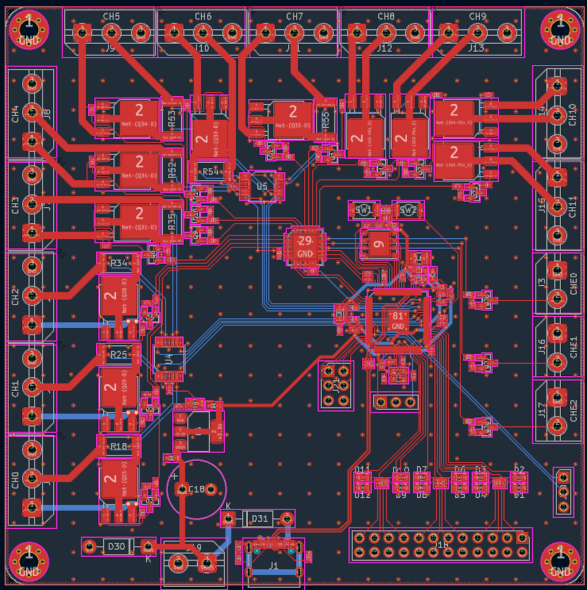
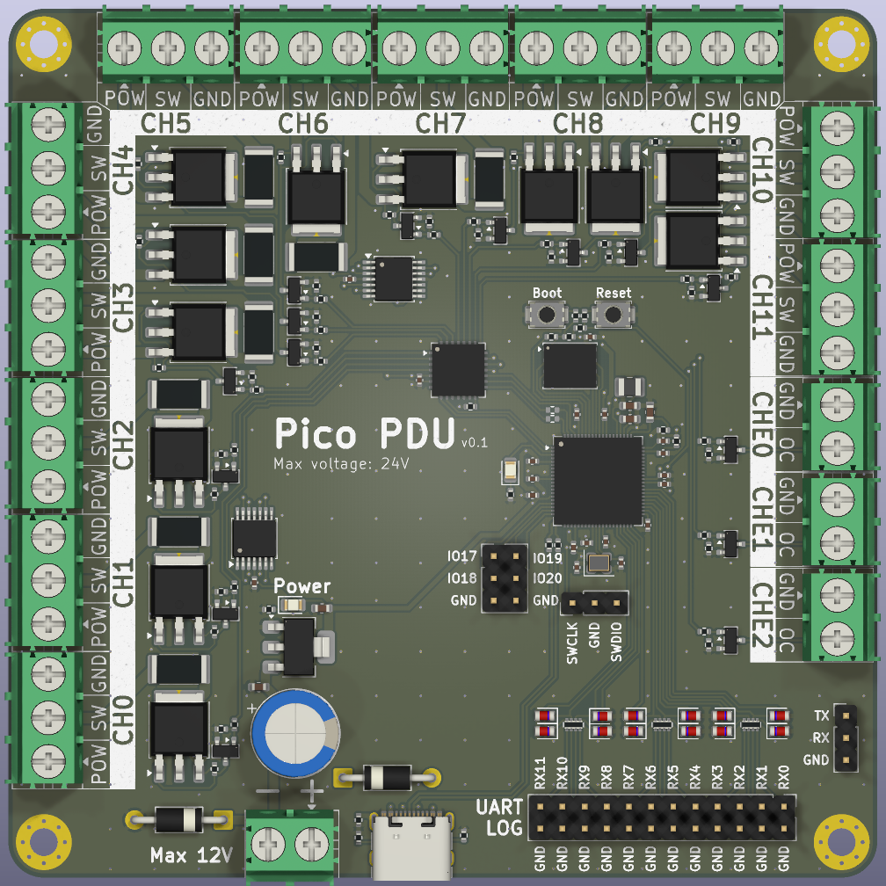

# pico-pdu

Power Distribution Unit (PDU) built around the Raspberry Pi **RP2350B** (Pico 2 class MCU).

| | |
|-|-|
|  |  | |

> Status: `v0.1` prototype / work in progress. The firmware won't be finished until the board gets manufactured and tested.

## Features

* 12 channels switched with high-side MOSFETs (8 with current sensing)
* 12 PIO-based UART log collectors, aggregating over USB-CDC
* USB-CDC shell for controlling the switches and log collectors

## Hardware (pcb/)

The board is built around the RP2350B with an external flash chip. The high-side switches are controlled by the MCP23017 I2C GPIO expander. Communication is performed over USB via a USB-C port.

### Current sensing

In the current sensing channels the power is routed via a shunt resistor, whose voltage drop is amplified by the INA4180 and goes to the MCU ADCs.

### Warm Boot

A "warm boot" line is routed from the expander to the MCU; it gets pulled high after the MCU boots up. If the line is high during the MCU boot, it assumes the expander to be the source of truth and reads the GPIO states from it.

### Log Collectors

The 12 log collector channels are routed through resistors and Zener diodes to the MCU and are read with PIO UART RX blocks.

## Firmware (firmware/)

The firmware runs on FreeRTOS using one core. The firmware exposes two USB CDC interfaces **PDU Console** and **Log Collector**.

## PDU Console

For controlling and monitoring the state of the PDU.

## Log Collector (not yet implemented)

Aggregated outputs of each UART. Incoming streams are prefixed with the stream index.

### Console commands

Connect to `PDU Console` at 115200 (e.g. `picocom /dev/ttyACM0`), prompt `pico-pdu> `:

```
help                        Print help
dfu                         Enter the bootloader
relay <on|off> <channel>    Turn on/off relay channel
state                       Human-readable relay + current report
state_raw                   Machine-parseable RELAY/MONITOR dump
log                         Change logger settings (stub)
```

## Build / flash

Requires Pico SDK + ARM toolchain (easiest: Pico VS Code extension, which picks up `pico-vscode.cmake` automatically).

```sh
cd firmware
cmake -B build
cmake --build build
# produces build/pico_pdu.uf2
```

Flash: hold `USB_Boot` + tap `Reset`, copy `pico_pdu.uf2` to the mass-storage device — or run `dfu` from the console (`reset_usb_boot(0,0)`), or use Picotool/OpenOCD via SWD.

## TODOs

- `relay_init/on/off` is in-RAM only, no GPIO/expander wiring.
- `monitor_read_channel_microamps()` returns random data; needs ADC/INA4180 bring-up.
- `cmd_logger` / `LOGGER` output unimplemented.
- `pico_pdu.c` demo only services one RX channel (`piouart0`); multi-channel RX + `NUM_LOGGERS=12` mapping TBD.
- Small bug surface: `send_circular_buffer()` wrap math, `console_command()` extra `\r\n`, `relay` channel bounds message (`0-NUM_RELAYS-1` vs `<=0` check).
